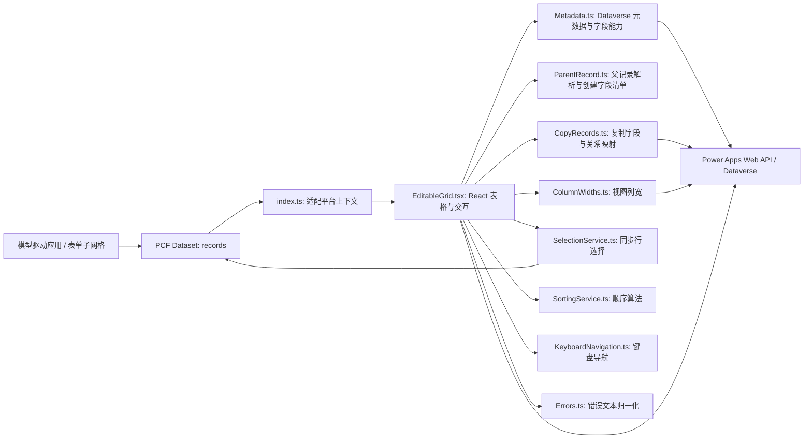
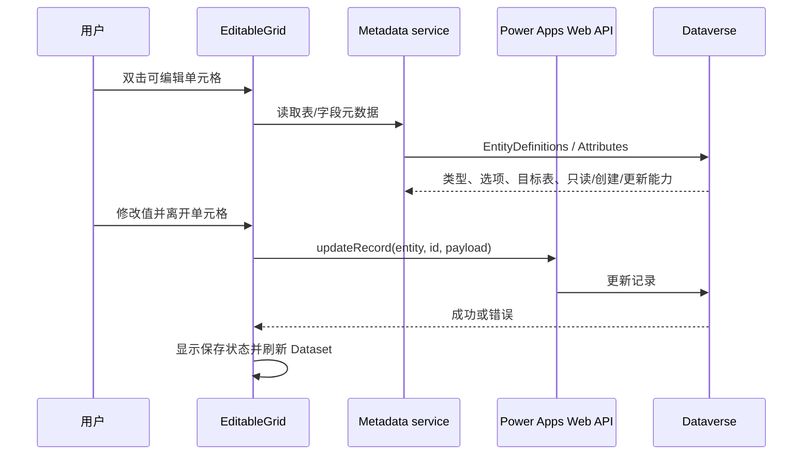
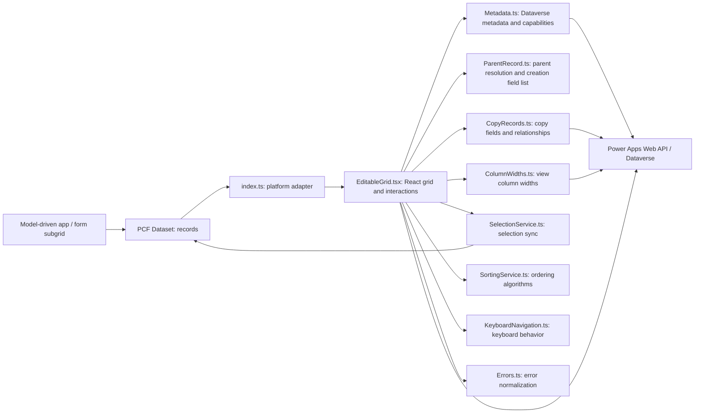
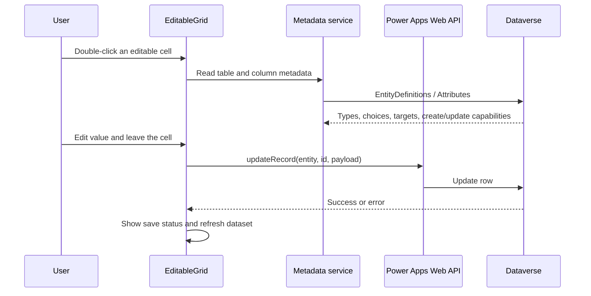

# System Architecture / 系统架构

Control / 控件: **1.0.4** · Solution / 解决方案: **1.0.4.0** · Publisher / 发布者: **KonaLz**

## 中文

### 项目定位

`EditableSortableSubgrid` 是一个 React Dataset PCF 虚拟控件，用于替换模型驱动应用**表单子网格的数据区域**。记录集合、列定义、分页和格式化显示值来自 Power Apps 提供的 Dataset。控件通过平台提供的 Web API、Utility 和 Navigation 能力读取元数据并执行记录操作。控件没有独立后端服务，也不把数据发到第三方服务。

### 组件关系

### 启动与渲染

1. `ControlManifest.Input.xml` 声明 Dataset `records`、必需绑定项 `SortOrder`（整数）和 `ParentLookup`（查找），隐藏的旧版兼容输入 `parentRecordId` / `parentEntityName`，并开启宿主 Dataset 命令栏、视图选择器、快速查找选项。
2. `index.ts` 从 `context.parameters.records` 读取 Dataset，从 `context.webAPI`、`context.navigation`、用户语言和 Maker 配置创建 `EditableGrid` 属性。
3. `EditableGrid.tsx` 根据 Dataset 的列定义和 `sortedRecordIds` 构造行列，使用 Dataset 格式化值呈现内容；隐藏列和绑定用排序列不作为普通显示列。
4. Dataset 记录、视图或加载状态更新时，React 视图重绘。分页由 Dataset 的 `paging.loadNextPage()` 驱动。

### 数据与保存流程

- 保存通过 `context.webAPI.updateRecord/createRecord/deleteRecord` 执行，权限、插件、业务规则和服务器验证仍由 Dataverse 控制。
- 文本、数字、日期、选项、布尔和查找编辑器由字段类型选择。查找和选项列表通过元数据/Dataverse API 获取。
- `CellValues.ts` 将已提交的显示值与原始值分开：`GridRow.values` 保存选项名称等显示文本，`GridRow.rawValues` 保存编号等编辑/提交值。草稿创建使用原始值；已有行在 Dataset 刷新前也显示名称，避免编号闪现。
- 配置了 `editableColumns` 时，仅允许名单中的列继续参与编辑判断；留空时根据 Dataverse 元数据判断当前显示列。两种情况都要求元数据明确允许更新，计算、汇总、自动编号和不可更新字段锁定。
- 日期序列化根据 `DateOnly`、`TimeZoneIndependent` 和 `UserLocal` 行为处理。
- 新行先在 UI 中作为草稿编辑；保存时构造创建负载，写入绑定父查找和排序值后调用 `createRecord`。
- 复制先读取完整源记录和表元数据，保留父级关联，排除主键、备用键、自动编号、只读/计算、系统字段及用户配置的排除项，再创建副本。复制不递归复制子记录、文件或图像。
- 删除使用 Power Apps 原生确认对话框，确认后逐条调用删除 API 并刷新 Dataset。

### 空子网格首行创建（1.0.3）

1. 用户添加草稿行并填写内容；保存时，元数据请求包含显示列、绑定的父查找列和排序列，即使后两者在视图中隐藏。
2. 从父查找列的 `Targets` 和 `ManyToOneRelationships` 取得父表类型。从入口传入的运行时父 ID（或旧版备用输入）、已有子记录的父查找值、唯一的 Dataset 父查找筛选条件依次解析父记录。
3. 使用关系定义中的 `ReferencingEntityNavigationPropertyName` 组成 `@odata.bind`，父表集合名取自元数据；不会假定查找逻辑名就是导航属性名。
4. 将可创建字段、父关系和排序值提交给 `createRecord`；成功后替换草稿 ID 并刷新 Dataset。父上下文不完整时停止创建；API 错误显示具体信息。

此前只请求显示列元数据，导致隐藏父查找的目标表类型缺失，已有父 ID 也无法完成解析。1.0.3 补齐隐藏绑定列及关系定义后，使用者于 2026-10-19 确认当前环境首行创建成功。`parentRecordId` / `parentEntityName` 仅作为隐藏的旧版兼容输入保留，无需在 Maker 中配置。

### 选择、键盘与排序

- Dataset 所选 ID 通过 `setSelectedRecordIds` 同步，使宿主命令能读取选择状态。
- 单元格活动状态由表格维护；方向键在单元格间移动，Tab 在表格内循环/按边界退出，Enter/F2 编辑，普通可打印字符可开始替换式输入。
- 拖动行更新显示顺序，并对相关记录写入间隔排序值。排序范围受当前表单父记录配置约束；目标整数排序列必须正确绑定并允许更新。
- 默认列宽优先从当前视图 `layoutxml` 读取；不可读取时使用 Dataset 列宽信息或固定回退值。拖动分隔线调整当前视图内宽度。

### 配置边界与安全

- `ParentLookup` 必须绑定子表中指向当前父记录的关系字段。创建首条记录时，控件优先尝试读取模型驱动子网格的运行时父记录 ID，再尝试 Dataset 唯一父查找筛选条件。运行时 `contextInfo` 未列入公开 PCF API，宿主若不提供该值，仍无法在空子网格中创建。
- `SortOrder` 必须绑定整数排序字段；没有正确绑定时，新增/拖动排序操作无法可靠持久化。
- `editableColumns` / `copyExcludedColumns` 使用字段逻辑名。`editableColumns` 可选用于限制范围；字段元数据在所有情况下都会参与可写判断。
- Metadata 和复制模块从当前 Power Apps 同源 Dataverse Web API 端点读取。没有应用专用 API 密钥或自建服务。
- Web API 仍受当前用户的 Dataverse 安全角色、表权限、字段安全配置及服务器端插件控制。
- 不要在公开截图、日志或示例数据中放真实客户信息、访问令牌、组织机密或个人数据。

### 测试范围与限制

仓库内有 Metadata、父记录解析、隐藏绑定字段、键盘、列宽、复制和错误解析的单元测试；1.0.3 的 2 项首行回归测试及 19 项元数据/复制关系测试均通过，生产构建与解决方案打包成功（0 警告、0 错误）。使用者已确认当前环境首行创建成功。README 中的本地构建也包含 TypeScript、lint 和 PCF production build。测试 Harness 不能代替真实租户验证。原生命令栏、Flow、特定表单/视图、不同安全角色、查找关系、分页和并发排序需要在目标 Power Apps 环境验证。

项目完全由 AI 参与编程开发，代码可能有 bug。架构描述反映当前源码意图，不构成对所有租户兼容性、数据完整性或生产适用性的保证。使用者应审查并先用非生产数据验证。

---

## English

### Purpose

`EditableSortableSubgrid` is a React Dataset PCF virtual control that replaces the **data region of a model-driven app form subgrid**. Power Apps supplies the dataset, column definitions, paging, and formatted display values. The control uses the platform Web API, Utility, and Navigation APIs to read metadata and perform record operations. It has no separate backend service and does not send data to a third-party service.

### Component map

### Initialization and rendering

1. `ControlManifest.Input.xml` declares the `records` dataset, required `SortOrder` (integer) and `ParentLookup` (lookup) bindings, hidden legacy `parentRecordId` / `parentEntityName` inputs, and the host dataset options for the command bar, view selector, and quick find.
2. `index.ts` reads the dataset from `context.parameters.records` and passes `context.webAPI`, `context.navigation`, language, and maker configuration into `EditableGrid`.
3. `EditableGrid.tsx` builds rows and columns from the dataset column definitions and `sortedRecordIds`, displaying dataset-formatted values. Hidden columns and the bound sort column are not rendered as ordinary data columns.
4. Dataset record, view, or loading changes cause a React render. Paging uses `dataset.paging.loadNextPage()`.

### Data and save flow

- Saves use `context.webAPI.updateRecord/createRecord/deleteRecord`; Dataverse remains responsible for privileges, plugins, business rules, and server validation.
- Editors are selected by column type: text, numeric, date, choice, Boolean, and lookup. Lookup and choice data comes from metadata and Dataverse APIs.
- `CellValues.ts` separates committed display text (`GridRow.values`) from raw editor/API values (`GridRow.rawValues`). Draft creation uses the raw option ID; persisted rows also retain the option label before the dataset refresh, preventing numeric ID flashes.
- When `editableColumns` is configured, only listed columns are considered for editing; when blank, Dataverse metadata determines which displayed fields are writable. In both cases, metadata must explicitly permit updates. Calculated, rollup, auto-number, and non-updatable columns are read-only.
- Date serialization accounts for `DateOnly`, `TimeZoneIndependent`, and `UserLocal` behavior.
- New rows are edited as drafts in the UI. On save, the control builds a create payload with the bound parent lookup and sort value, then calls `createRecord`.
- Copy reads the complete source row and table metadata, retains the parent relationship, excludes primary/alternate keys, auto-number, read-only/calculated and system fields, and applies the configured exclusion list before creating a copy. It does not recursively copy child rows, files, or images.
- Delete uses the native Power Apps confirmation dialog, then calls the delete API for each confirmed row and refreshes the dataset.

### First-row creation in an empty subgrid (1.0.3)

1. The user adds and fills a draft row. On save, the metadata request includes displayed columns plus the bound parent lookup and sort column, even when those bindings are hidden from the view.
2. Parent table types come from lookup `Targets` and `ManyToOneRelationships`. Parent resolution checks the runtime ID passed by the entry point (or a legacy fallback input), existing child-row lookup values, and then a unique dataset parent lookup filter.
3. The parent `@odata.bind` key uses the relationship's `ReferencingEntityNavigationPropertyName`; the entity set comes from metadata. A lookup logical name is not assumed to be its navigation property.
4. Creatable values, the parent binding, and the sort value are sent to `createRecord`. On success, the draft ID is replaced and the dataset refreshed. Missing parent context stops creation; API failures include the underlying error details.

Previously, metadata was requested only for visible columns. A hidden parent lookup therefore had no target type, so even an available parent ID could not be resolved. After 1.0.3 included hidden bindings and relationship definitions, the project owner confirmed first-row creation in their environment on 2026-10-19. The hidden `parentRecordId` / `parentEntityName` inputs remain for backward compatibility and need no Maker configuration.

### Selection, keyboard, and ordering

- Selected IDs are synchronized to the dataset using `setSelectedRecordIds`, allowing host commands to read the selection.
- The grid tracks an active cell. Arrow keys move between cells; Tab moves through or exits the grid at its boundary; Enter/F2 enters edit mode; printable characters can begin replacement-style editing.
- Dragging changes the visible row order and writes spaced sort values to affected records. Ordering depends on the configured parent context; the bound integer sort column must be correct and updateable.
- Default widths are read from the active view's `layoutxml` when accessible, falling back to dataset width information or a fixed default. Users can resize columns in the current view.

### Configuration and security boundaries

- `ParentLookup` must bind to the child-table relationship pointing to the current parent row. For an empty subgrid, the control first attempts to read the parent ID from model-driven runtime `contextInfo`, then a unique parent lookup filter. `contextInfo` is not part of the published PCF API; if the host does not expose it, the empty-grid create path cannot resolve a parent.
- `SortOrder` must bind to an integer sort column; add and reorder operations cannot be reliably persisted without it.
- `editableColumns` and `copyExcludedColumns` take logical column names. `editableColumns` is an optional restriction; metadata determines writability in all cases.
- Metadata and copy operations use the same-origin Dataverse Web API endpoint exposed to the current Power Apps session. There is no app-specific API key or custom service.
- Web API operations remain subject to the current user's Dataverse security roles, table privileges, field security, and server-side plugins.
- Do not include real customer information, access tokens, organizational secrets, or personal data in public screenshots, logs, or examples.

### Verification scope and limitations

The repository contains unit tests for metadata, parent resolution, hidden bindings, keyboard navigation, column widths, copying, and error parsing. For 1.0.3, two first-row regression tests and 19 metadata/copy relationship tests passed. Production build and solution packaging completed with zero warnings and errors. The project owner confirmed first-row creation in their environment. The local build also runs TypeScript, lint, and the PCF production build. A test harness is not a substitute for testing in a real tenant. Native command-bar behavior, flows, specific forms/views, security roles, lookup relationships, paging, and concurrent ordering must be verified in the target Power Apps environment.

This project was programmed entirely with AI assistance. Bugs may remain. This document describes the current source design; it does not guarantee compatibility with every tenant, data integrity, or fitness for production. Review the code and validate with non-production data first.
