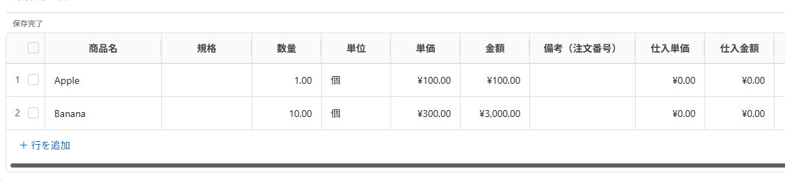
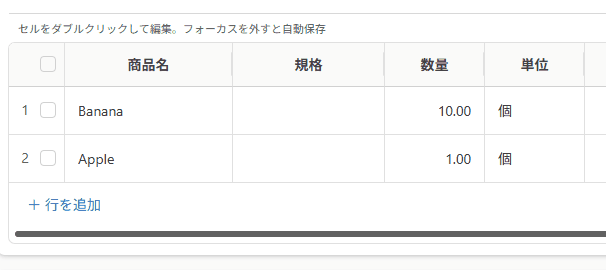
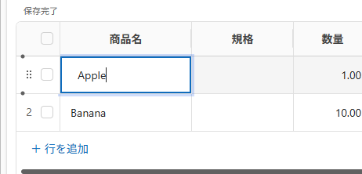
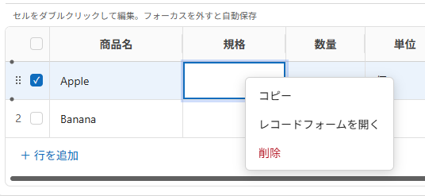
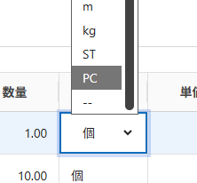
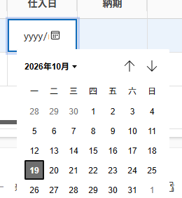

# EditableSortableSubgrid

**A Dataverse model-driven app subgrid PCF with inline editing, keyboard navigation, record actions, and row reordering.**

> **AI development notice:** This project was programmed entirely with AI assistance. It may contain defects, security issues, or behavior that has not been verified in every Power Apps environment. Review the source, test with non-production data, and validate the behavior and permissions in your own environment before relying on it. Use at your own risk.

**AI 开发说明：** 本项目完全由 AI 参与编程开发，可能存在缺陷、安全问题，或尚未在所有 Power Apps 环境中验证的行为。请先检查代码，在非生产数据上测试，并在自己的环境中验证功能与权限后再使用。使用风险由使用者自行评估。

English | [简体中文](#简体中文)

Control version: **1.0.4** · Solution version: **1.0.4.0** · Publisher: **KonaLz**

## Screenshots

**Grid overview / 表格总览**



**Insert, reorder, and copy rows / 插入行、拖动排序与复制记录**



| Inline editing / 单元格编辑 | Record actions / 右键记录菜单 |
|---|---|
|  |  |

| Choice dropdown / 选项下拉菜单 | Date picker / 日期选择器 |
|---|---|
|  |  |


## Features

- Dataset-backed grid that follows the current view's columns, labels, formatted values, row order, and paging.
- Inline cell editing with automatic save when editing ends; Dataverse metadata is used to keep calculated and read-only columns non-editable.
- Text, numeric, date, choice, Boolean, and lookup editors, subject to the field metadata and the user's Dataverse privileges.
- Cell selection and keyboard navigation with arrow keys, Tab, Enter, F2, and type-to-edit behavior.
- Row selection synchronized with the host Dataset, so model-driven app commands can use the selected records.
- Drag-and-drop row ordering with updates to a configured integer sort column.
- Add-row actions, including the first row in an empty related subgrid, with automatic parent association.
- View-based default column widths and interactive column resizing.
- Context-menu actions to copy a record, open a single record form, and delete selected records with a Power Apps confirmation dialog.
- Copying retains the parent relationship, skips primary keys, calculated/read-only fields and other system fields, and supports a configurable exclusion list.
- Chinese, Japanese, and English UI strings.
- Dataset command bar, view selector, and quick find are enabled in the PCF manifest; their actual visibility and commands depend on the host app configuration.

## Requirements and configuration

> **Before using drag sorting:** Create a writable **Whole Number (integer)** column on the **child table**, then bind the control’s **SortOrder** setting to it. For example, create a column with logical name `new_sortorder`. This column stores row order; without the integer column and binding, drag sorting cannot be saved. The column can stay hidden in the view.

- A Power Apps model-driven app using a **form subgrid**.
- Dataverse Web API access and user privileges to read metadata and create, update, or delete the relevant rows.
- Bind the Dataset's **SortOrder** property to the child table's integer ordering column.
- Bind **ParentLookup** to the child table lookup that points to the current parent row. This relationship is required to set the parent on new and copied rows.
- The control resolves the parent ID automatically from model-driven subgrid runtime context, existing child rows, or a unique parent lookup filter. No manual parent ID configuration is needed. The bound parent lookup can stay hidden in the view; its metadata and relationship navigation property are loaded separately.
- Optionally configure **Editable columns** (`editableColumns`) as a comma-separated allowlist of child-table logical column names. When left blank, the control uses Dataverse metadata to decide which displayed fields are writable. In either case, calculated and otherwise read-only fields stay locked.
- Optionally configure **Columns excluded when copying** as comma-separated logical names, for example `new_externalid,new_note`. Unique keys, primary IDs, calculated/read-only fields, auto-number fields, and system columns are excluded automatically.
- Add the control to the form subgrid and publish the app changes. Keep the model-driven app's native command bar configuration as required by your app.

Property labels are localized in the maker UI. Use Dataverse **logical names**, not display labels, for column lists.

## Build from source

Prerequisites: Node.js/npm, .NET SDK, Power Platform CLI (`pac`), and access to the required package feeds.

```powershell
npm ci
npm run typecheck
npm run lint
npm run build
```

For a local PCF test harness:

```powershell
npm start
```

The test harness is useful for UI development. It does not prove that Web API operations, command-bar integration, lookup metadata, or permissions work in a real Dataverse environment.

This repository includes the solution project at `KonaLzSolution/`. Build both distributable packages from the repository root with `dotnet build KonaLzSolution/KonaLzSolution.cdsproj --configuration Release`. The generated files are `KonaLzSolution/bin/Release/EditableSortableSubgrid.zip` (unmanaged) and `KonaLzSolution/bin/Release/EditableSortableSubgrid_managed.zip` (managed). Do not run `pac pcf push` against a production environment.

## Documentation

- [System architecture (中文 / English)](EditableSortableSubgrid/docs/ARCHITECTURE.md)
- [Copy configuration](EditableSortableSubgrid/docs/COPY_CONFIGURATION.md)
- [Dataverse schema mapping](EditableSortableSubgrid/docs/SCHEMA_MAPPING.md)
- [Platform compatibility notes](EditableSortableSubgrid/docs/PLATFORM_COMPATIBILITY.md)
- [Deployment notes](EditableSortableSubgrid/docs/DEPLOYMENT.md)
- [Test report](EditableSortableSubgrid/docs/TEST_REPORT.md)

## Known limitations

- Automatic parent context uses `context.mode.contextInfo.entityId` when available. This runtime field is not part of the published PCF API. First-row creation was confirmed by the project owner in their model-driven form subgrid on 2026-10-19; other hosts and environments still require validation.

- Platform-specific behavior must be verified in the target tenant, app, form, view, and security roles. Local builds and the PCF test harness cannot validate all Dataverse behavior.
- Custom sort persistence requires a correctly bound writable integer column. The control updates row sort values; server-side business rules, concurrent edits, and paging behavior can affect the final order.
- Copying ordinary scalar and supported lookup values does not clone related child records, files, or images. Required columns, plugins, and business rules may reject a copy.
- The native command bar is hosted by Power Apps. Enabling its manifest options does not create missing commands or guarantee identical rendering in every host.

## License

Licensed under the [MIT License](LICENSE). Copyright (c) 2026 KonaLz. Third-party dependencies retain their own licenses.

---

## 简体中文

控件版本：**1.0.4** · 解决方案版本：**1.0.4.0** · 发布者：**KonaLz**

**一个用于 Dataverse 模型驱动应用表单子网格的 PCF 控件，提供单元格编辑、键盘操作、记录菜单和行排序。**

> **AI 开发说明：** 本项目完全由 AI 参与编程开发，可能存在缺陷、安全问题，或尚未在所有 Power Apps 环境中验证的行为。请先检查代码，在非生产数据上测试，并在自己的环境中验证功能与权限后再使用。使用风险由使用者自行评估。

### 截图

表格总览、插入行/拖动排序/复制的 GIF，以及编辑、右键菜单、选项和日期截图，已放在上方[截图与演示区域](#screenshots)。文件统一保存在 `EditableSortableSubgrid/docs/images/`。

### 功能

- 根据当前视图 Dataset 显示列、列标题、格式化值、记录顺序和分页数据。
- 双击单元格进入编辑，结束编辑后自动保存；根据 Dataverse 元数据阻止编辑计算列和只读列。
- 支持文本、数字、日期、选项、布尔值和查找字段编辑，具体取决于字段元数据和当前用户权限。
- 支持单元格选择、方向键移动、Tab、Enter、F2 和按键直接开始输入。
- 将行选择同步到宿主 Dataset，供模型驱动应用命令读取所选记录。
- 拖动行调整顺序，并写入绑定的整数排序字段。
- 支持在空的关联子网格中创建首行并自动关联父记录，也支持继续添加后续行。
- 支持读取视图默认列宽和拖动调整列宽。
- 右键菜单支持复制记录、打开单条记录表单，以及通过 Power Apps 确认框删除所选记录。
- 复制记录时保留父记录关联；自动跳过主键、计算/只读字段和系统字段；支持配置额外排除字段。
- 中文、日文和英文界面。
- Manifest 已启用 Dataset 命令栏、视图选择器和快速查找选项；实际显示内容仍由宿主应用配置决定。

### 环境要求与配置

> **拖动排序前请先创建排序列：** 在**子表**中创建一个可写的**整数列（Whole Number）**，然后将控件的 **SortOrder（排序序号字段）**绑定到该列。例如可以创建逻辑名为 `new_sortorder` 的列。该列用于保存行顺序；没有整数列或未绑定时，拖动后的顺序无法保存。排序列可以在视图中隐藏。

- Power Apps 模型驱动应用中的**表单子网格**。
- 可访问 Dataverse Web API，并具备读取元数据及对相关行执行所需创建、更新、删除操作的权限。
- 将 Dataset 的 **SortOrder** 绑定到子表的整数排序列。
- 将 **ParentLookup** 绑定到指向当前父记录的子表查找列。创建行和复制时保留父子关系都需要此配置。
- 控件从模型驱动子网格运行时上下文、已有子记录或唯一的父查找筛选条件自动获取父记录。无需配置父记录 ID；绑定的父查找列可以在视图中隐藏，组件会另外加载其元数据及关系导航属性。
- 可选将 **Editable columns（可编辑列）**（`editableColumns`）配置为以逗号分隔的子表逻辑列名白名单。留空时由 Dataverse 元数据决定当前显示列中哪些可写；无论哪种方式，计算列及其他只读列都会锁定。
- 可选配置 **Columns excluded when copying（复制时排除的列）**，填写以逗号分隔的逻辑名，例如 `new_externalid,new_note`。主键、备用键、计算/只读、自动编号和系统字段会自动排除。
- 在表单子网格添加控件并发布应用变更。原生命令栏需按应用本身的配置保留和验证。

Maker 属性中的列名请填写 Dataverse **逻辑名**，不要填显示名称。

### 从源代码构建

需要 Node.js/npm、.NET SDK、Power Platform CLI（`pac`）以及可访问所需依赖包源。

```powershell
npm ci
npm run typecheck
npm run lint
npm run build
```

运行本地 PCF Test Harness：

```powershell
npm start
```

Test Harness 适合开发界面，但不能证明真实 Dataverse Web API、原生命令栏、查找元数据或权限配置都能正常工作。

本仓库已包含 `KonaLzSolution/` 解决方案工程。从仓库根目录执行 `dotnet build KonaLzSolution/KonaLzSolution.cdsproj --configuration Release`，即可生成两种可分发包：`KonaLzSolution/bin/Release/EditableSortableSubgrid.zip`（非托管）和 `KonaLzSolution/bin/Release/EditableSortableSubgrid_managed.zip`（托管）。请勿对生产环境运行 `pac pcf push`。

### 文档

- [系统架构（中文 / English）](EditableSortableSubgrid/docs/ARCHITECTURE.md)
- [复制功能配置](EditableSortableSubgrid/docs/COPY_CONFIGURATION.md)
- [Dataverse 字段映射](EditableSortableSubgrid/docs/SCHEMA_MAPPING.md)
- [平台兼容性说明](EditableSortableSubgrid/docs/PLATFORM_COMPATIBILITY.md)
- [部署说明](EditableSortableSubgrid/docs/DEPLOYMENT.md)
- [测试报告](EditableSortableSubgrid/docs/TEST_REPORT.md)

### 已知限制

- 自动获取父记录时会使用宿主提供的 `context.mode.contextInfo.entityId`，该运行时字段未列入微软公开 PCF API。项目使用者已于 2026-10-19 在当前模型驱动表单子网格确认首行创建成功；其他宿主和环境仍需验证。

- 平台行为必须在目标租户、应用、表单、视图和安全角色下验证。本地构建和 Test Harness 无法覆盖所有 Dataverse 行为。
- 持久化行排序依赖正确绑定且可写的整数列；服务端业务规则、并发编辑和分页可能影响最终顺序。
- 复制普通字段和支持的查找值不会复制关联子记录、文件或图像。必填列、插件或业务规则也可能拒绝创建。
- 原生命令栏由 Power Apps 宿主管理。Manifest 开启命令栏选项不会自动创建缺失命令，也不能保证所有宿主中显示完全一致。

### 许可证

本项目采用 [MIT 许可证](LICENSE)，版权署名为 Copyright (c) 2026 KonaLz。第三方依赖仍遵循各自的许可证。


